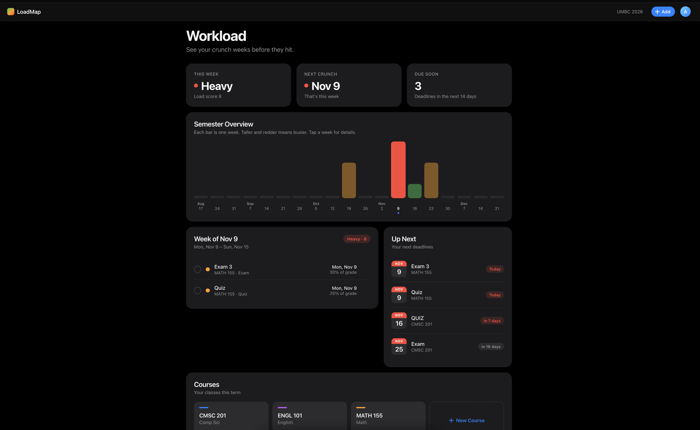

# LoadMap

**See your crunch weeks before they hit.**

LoadMap is a semester workload planner for students. Add your courses and their exams, projects, quizzes and homework, and LoadMap scores every week of the term so you can spot the heavy ones weeks in advance — and start early.

**Live demo:** [loadmap.onrender.com](https://loadmap.onrender.com)
<sub>Hosted on a free plan, so the first visit may take up to a minute while the server wakes up.</sub>



## Why I built it

Syllabi list every deadline, but they're spread across five documents and never show you the week where three exams and a project land at once. I wanted one view that answers a single question: *which weeks are going to be rough, and how soon?*

## Features

- **Semester overview chart.** One bar per week, colored light / moderate / heavy by how much is due.
- **Week detail.** Tap any week to see exactly what's due, by course and type.
- **Up Next & Due Soon.** Your next deadlines with countdowns.
- **Mark work done.** Finished assignments are crossed off and stop counting toward the week's load.
- **Edit anything.** Courses and assignments can be added, edited or deleted.
- **Per-user accounts.** Each student's courses, assignments and term dates are private to their account.

## How the workload score works

Each assignment gets an impact rating from 1 to 5:

| Type | Base impact |
|---|---|
| Exam, Project | 4 |
| Quiz | 2 |
| Homework, Discussion | 1 |

Anything worth **10% or more** of the final grade gets +1 (capped at 5). A week's score is the sum of its unfinished assignments: **8+ is heavy, 4–7 moderate, under 4 light.** The logic lives in [`WorkloadService.java`](src/main/java/com/loadmap/planner/service/WorkloadService.java).

## Tech stack

| Layer | Technology |
|---|---|
| Backend | Java 25, Spring Boot 4 (Spring Web MVC, Spring Data JPA, Bean Validation) |
| Security | Spring Security: session-based login, BCrypt password hashing |
| Database | PostgreSQL in production, H2 for local development |
| Frontend | HTML, CSS and vanilla JavaScript calling a REST API |
| Deployment | Docker multi-stage build on Render |

## Security & design decisions

- **Passwords are never stored.** Only BCrypt hashes are saved, and login errors don't reveal whether an email has an account.
- **Data is scoped to the owner.** Every query filters by the logged-in user (for example `findByIdAndOwnerId`), so changing an ID in a URL returns 404 instead of someone else's data.
- **Validation on the server, not just the page.** Bean Validation rules on the entities return clear error messages through a central `@RestControllerAdvice`.
- **Two environments, one codebase.** H2 means zero setup for local development; a Spring `prod` profile switches to PostgreSQL so data survives redeploys. Database credentials come from environment variables and are never committed.
- **HTTPS-only session cookie** in production.

## Run it locally

Requires **JDK 25**. No database to install — local development uses an H2 file in `./data`.

```bash
git clone https://github.com/JuliusA9/loadmap.git
cd loadmap
./mvnw spring-boot:run
```

Then open [http://localhost:8080](http://localhost:8080) and create an account.

## Deploy

The included `Dockerfile` builds the app and runs it with the `prod` profile. Set these environment variables on your host:

| Variable | Example |
|---|---|
| `DB_URL` | `jdbc:postgresql://<host>:5432/<database>` |
| `DB_USERNAME` | your database user |
| `DB_PASSWORD` | your database password |

## REST API

All endpoints except signup and login require a logged-in session.

| Method | Endpoint | Description |
|---|---|---|
| `POST` | `/api/auth/signup` | Create an account and log in |
| `POST` | `/api/auth/login` | Log in |
| `POST` | `/api/auth/logout` | Log out |
| `GET` | `/api/auth/me` | Current user |
| `GET` / `PUT` | `/api/settings` | Read or save the semester dates |
| `GET` / `POST` | `/api/courses` | List or add courses |
| `GET` / `PUT` / `DELETE` | `/api/courses/{id}` | Read, edit or delete a course (and its assignments) |
| `GET` / `POST` | `/api/courses/{id}/assignments` | List or add a course's assignments |
| `GET` | `/api/assignments` | All of my assignments |
| `PUT` / `DELETE` | `/api/assignments/{id}` | Edit or delete an assignment |
| `PATCH` | `/api/assignments/{id}/completed` | Mark an assignment done or not done |
| `GET` | `/api/workload` | Weekly load scores |

## Roadmap

- CSRF tokens and login rate limiting
- Password change/reset and account deletion
- Automated tests for the workload scoring and data-access rules
- Calendar import (`.ics`) from course websites

## Author

**Julius Atemafac Jr** · [GitHub](https://github.com/JuliusA9)
